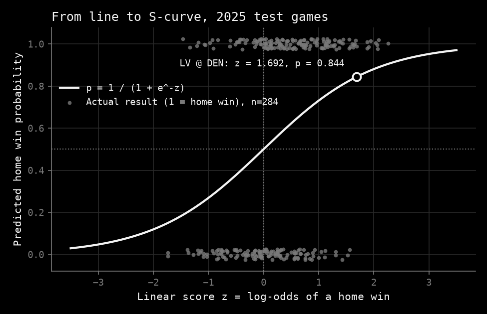
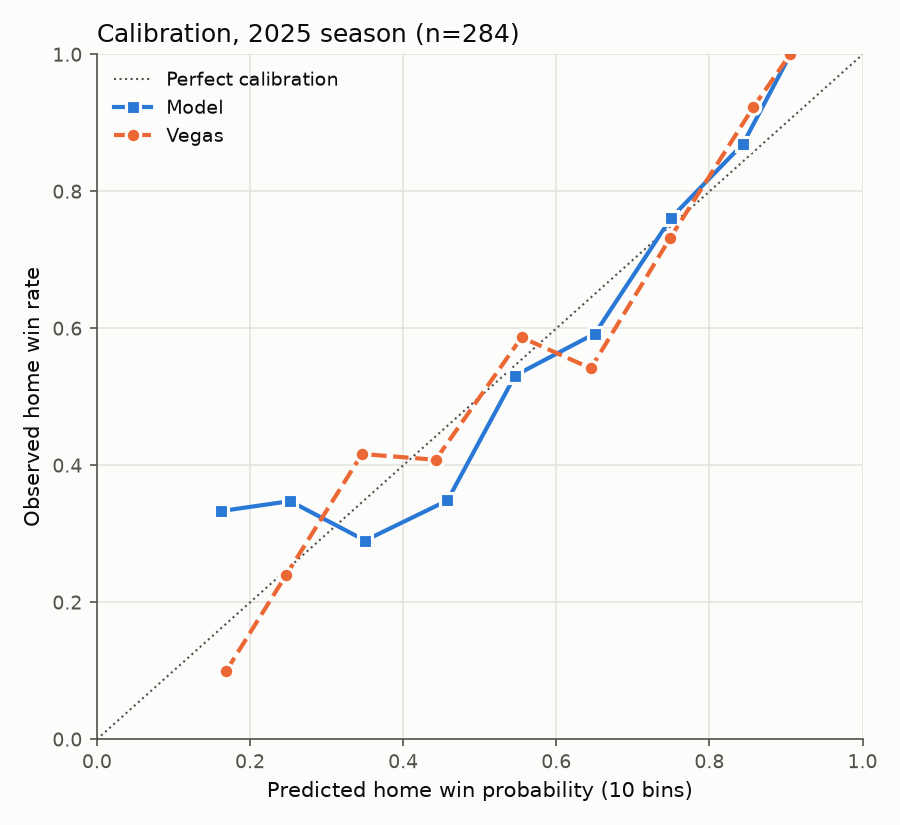
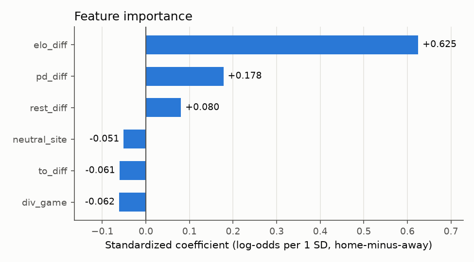

# NFL game outcome predictor

Home-team win probability for NFL games from a logistic regression on
pre-kickoff features (Elo + last-5-game form), evaluated honestly against
"always pick home" and the Vegas line.

## How the model calculates a probability

Every number in this section is read from the frozen `models/pipeline.joblib`
or computed by `scripts/explain_model.py` (saved to `reports/model_explained.json`).
Nothing is refitted. `log` is the natural log throughout.

### 1. The idea

A game is a win (1) or a loss (0). A straight line through those points would
predict values below 0 and above 1, which are not probabilities.

Logistic regression fits the straight line in **log-odds** space instead, then
maps it back to an S-shaped curve that stays between 0 and 1:

$$\operatorname{logit}(p) = \log\frac{p}{1-p}$$

As $p$ goes from 0 to 1, the log-odds go from $-\infty$ to $+\infty$, and
$p = 0.5$ maps to $\log 1 = 0$.

### 2. The model equation

The line, in log-odds space:

$$z = \log\frac{p}{1-p} = b_0 + w_1x_1 + w_2x_2 + \dots + w_6x_6$$

Each $x_j$ is a home-minus-away feature, standardized with the 2006-2023
training mean and SD stored in the scaler: $x_j = (\text{raw}_j - \text{mean}_j)/\text{SD}_j$.

From log-odds back to a probability:

$$\frac{p}{1-p} = e^{z} \;\Rightarrow\; p = e^{z} - p\,e^{z} \;\Rightarrow\; p\,(1+e^{z}) = e^{z} \;\Rightarrow\; p = \frac{e^{z}}{1+e^{z}} = \frac{1}{1+e^{-z}}$$

| Term | Meaning | Coefficient $w$ | Odds ratio $e^w$ | SE | $z = w/\text{SE}$ | p-value |
|---|---|---|---|---|---|---|
| `intercept` | $b_0$: log-odds with every feature at its training mean | 0.262 | 1.300 | 0.031 | 8.342 | $7.3\times10^{-17}$ |
| `elo_diff` | Elo rating difference (1 SD = 152.496 points) | 0.625 | 1.868 | 0.053 | 11.786 | $4.6\times10^{-32}$ |
| `pd_diff` | last-5 point differential difference (1 SD = 10.840) | 0.178 | 1.195 | 0.058 | 3.064 | 0.002 |
| `to_diff` | last-5 turnover margin difference (1 SD = 1.231) | -0.061 | 0.941 | 0.039 | -1.531 | 0.126 |
| `rest_diff` | days of rest difference (1 SD = 2.472) | 0.080 | 1.084 | 0.032 | 2.555 | 0.011 |
| `div_game` | division game, 0/1 (1 SD = 0.483) | -0.062 | 0.940 | 0.031 | -1.963 | 0.050 |
| `neutral_site` | neutral site, 0/1 (1 SD = 0.104) | -0.051 | 0.950 | 0.032 | -1.627 | 0.104 |

$w$ is the change in log-odds per 1 SD of the feature. $e^w$ is what the home
team's odds are multiplied by: 152.496 more Elo points than the opponent
multiplies the odds by 1.868.

The coefficients are the model's (scikit-learn). SE, $z$ and p come from an
unpenalized statsmodels `Logit` on the same standardized data, because
scikit-learn's fit has a small L2 penalty (C = 1.0) and reports no standard
errors; the two sets of coefficients differ by less than 0.001.

Elo, recent point differential and rest are clearly real effects. Division
games are borderline (p = 0.0496). Turnover margin (p = 0.126) and neutral site
(p = 0.104, only 51 neutral games in training) could be noise.

**Intercept.** Because the features are standardized, $b_0$ is the log-odds
when every feature is at its *training mean*: $1/(1+e^{-0.262}) = 0.565$.
For truly equal teams at a non-neutral site (every raw difference 0, not a
division game), $z = 0.336$ and $p = 0.583$: home field is worth about
8 points of probability over a coin flip.



Every test game sits on the same S-curve. What moves a game left or right is
only its score $z$; the dots at 0 and 1 are the actual results.

### 3. Worked example: LV @ DEN, 2025 week 10

The first game of week 10 of the 2025 test season (Thursday, 6 Nov 2025).
Before kickoff: Elo DEN 1655.092, LV 1355.488; last-5 point differential
DEN +6.0, LV -11.4; last-5 turnover margin DEN -0.2, LV -0.8; both teams on
4 days of rest; division game; not neutral.

| Feature | Raw (home − away) | Train mean | Train SD | Scaled $x$ | $w$ | $w \cdot x$ |
|---|---|---|---|---|---|---|
| `elo_diff` | 299.604 | -3.098 | 152.496 | 1.985 | 0.625 | 1.240 |
| `pd_diff` | 17.400 | -0.359 | 10.840 | 1.638 | 0.178 | 0.291 |
| `to_diff` | 0.600 | -0.011 | 1.231 | 0.496 | -0.061 | -0.030 |
| `rest_diff` | 0.000 | -0.095 | 2.472 | 0.038 | 0.080 | 0.003 |
| `div_game` | 1.000 | 0.371 | 0.483 | 1.303 | -0.062 | -0.080 |
| `neutral_site` | 0.000 | 0.011 | 0.104 | -0.105 | -0.051 | 0.005 |

$$z = 0.262 + 1.240 + 0.291 - 0.030 + 0.003 - 0.080 + 0.005 = 1.692$$

(The rounded terms add to 1.691; the unrounded sum is 1.692.)

$$p = \frac{1}{1+e^{-1.692}} = 0.844$$

The app shows **DEN 84.4%** for this game (`/game/2025_10_LV_DEN`); the script
asserts that its $p$ equals the app's `live.home_win_prob` exactly. Elo alone
contributes 1.240 of the 1.692; being a division game costs Denver 0.080.

Vegas: moneyline DEN -500 / LV +380 gives 0.833 and 0.208; with the vig
removed, $0.833/(0.833+0.208) = 0.800$. Actual result: **DEN won 10-7.** Both
picked Denver; the model was more confident.

### 4. How the coefficients were found: maximum likelihood

In log-odds space a win sits at $+\infty$ and a loss at $-\infty$, so the
residuals are infinite and least squares cannot be used.

Instead, each candidate line gives every training game a probability $p_i$
through the S-curve, and the line is scored by how likely it makes the results
that actually happened:

$$\text{LL} = \sum_{\text{home wins}} \log p_i \;+\; \sum_{\text{home losses}} \log(1-p_i)$$

The fit picks the coefficients with the highest log-likelihood. It does not
rotate lines by trial and error: an iterative optimizer (scikit-learn's
`lbfgs`) follows the slope of LL uphill until it stops improving. Strictly,
scikit-learn maximizes LL minus the small L2 penalty.

On the 4,642 training games (2006-2023 regular season): **LL(fit) = -2912.230.**
The unpenalized maximum is the same to three decimals, so the penalty barely
matters here.

### 5. Goodness of fit

**LL(null)** is the intercept-only model: every game gets the training home-win
rate, $2591/4642 = 0.558$.

$$\text{LL(null)} = 4642\,\big[\,0.558\log 0.558 + 0.442\log 0.442\,\big] = -3186.109$$

**McFadden $R^2$** compares the two, the way linear-regression $R^2$ compares
$SS(\text{mean})$ and $SS(\text{fit})$:

$$R^2_{\text{McFadden}} = \frac{\text{LL(null)} - \text{LL(fit)}}{\text{LL(null)}} = \frac{-3186.109 - (-2912.230)}{-3186.109} = 0.086$$

McFadden $R^2$ values of 0.1-0.3 are often quoted as normal for noisy outcomes;
0.086 is a little below that, which is what single NFL games look like. Even the market is
low: on the 2025 test season, with "always home" as the null, the model's
McFadden $R^2$ is 0.098 and Vegas's is 0.123. McFadden $R^2$ is not the share of
variance explained, so it is not comparable to a linear-regression $R^2$.

**Likelihood-ratio test** (are the features, together, better than nothing?):

$$\chi^2 = 2\,\big(\text{LL(fit)} - \text{LL(null)}\big) = 2\,(-2912.230 + 3186.109) = 547.758$$

with df = 6 (the six features the fit adds to the intercept-only model).
p-value: $4.3\times10^{-115}$, so the relationship is not a fluke.

**Single coefficient** (Wald test): $z^2 = \chi^2$ with df = 1. For `elo_diff`,
$11.786^2 = 138.900$. For `div_game`, $(-1.963)^2 = 3.854$, just above 3.841,
the 5% cut-off for $\chi^2$ with 1 df, hence p = 0.0496.

### 6. Neutral sites

At a neutral site "home" is only a label, so the app averages both labelings,
$p = \big(p(A\text{ home}) + 1 - p(B\text{ home})\big)/2$ (see [Model](#model));
LV @ DEN was not neutral, so this did not apply.

### 7. Why this matters for the Vegas comparison

The results below score the model three ways: accuracy (right picks), Brier
score (mean squared error of $p$) and log loss, which is the same
log-likelihood, sign-flipped and averaged per game on the test season:
$-\text{LL}/n = 177.278/284 = 0.624$.

## Results: 2025 test season (evaluated once)

284 games (regular season + playoffs; 1 tie excluded; every game had a line).

| Method | Accuracy | Log loss | Brier |
|---|---|---|---|
| **Model** | **0.655** | **0.624** | **0.218** |
| Always home | 0.535 | 0.692 | 0.249 |
| Vegas (moneyline, vig removed) | 0.660 | 0.607 | 0.211 |

The model beats the home baseline on every metric and trails Vegas on every
metric, which is the expected ordering: the market knows about injuries,
quarterback changes and weather; this model does not. Playoffs alone: 13 games,
accuracy 0.769, too few to read anything into.

Validation season (2024, 285 games) for comparison: model 0.674 / 0.622 / 0.216,
home 0.547 / 0.689 / 0.248, Vegas 0.707 / 0.589 / 0.201.



Calibration is reasonable above 0.5. Below about 0.4 the model is
under-confident about home underdogs (they won more often than predicted),
but with 284 games spread over 10 bins, the low-probability bins are small.

## Model

`StandardScaler` + `LogisticRegression` (seed 42), trained on 2006-2023
regular-season games. Features are home-minus-away differences; there is no
home/away flag, because the intercept carries home advantage.

| Feature | Meaning |
|---|---|
| `elo_diff` | Elo rating difference before kickoff |
| `pd_diff` | last-5-game point differential |
| `to_diff` | last-5-game turnover margin |
| `rest_diff` | days of rest |
| `div_game` | division game flag |
| `neutral_site` | `location == "Neutral"` (international games, Super Bowl) |

**Points for/against vs point differential.** `pd_diff` equals
`pf_diff - pa_diff` exactly, so using all three would split one effect across
collinear coefficients. We keep `pd_diff` and drop `pf_diff`/`pa_diff`.

**Neutral sites at prediction time.** With only 51 neutral-site training
games, the model learned a spurious penalty for the team *listed* as home
(equal teams got 46%, not 50%). The app therefore averages both labelings for
neutral games, `p = (p(A listed home) + 1 - p(B listed home)) / 2`, so equal
teams get exactly 50% and the answer does not depend on which team is listed
first (`live.home_win_prob`, tested in `tests/test_live.py`). Non-neutral
games use the model unchanged. The test-season metrics above were computed
before this adjustment; it affects only the ~5 neutral games per season.



Coefficients are on standardized features (log-odds per 1 SD). Elo dominates.
`to_diff` is slightly *negative*: turnover margin is largely luck, so among
teams with the same Elo and point differential, the one with the better
turnover margin is a bit overrated.

### Elo

| Parameter | Value | How chosen |
|---|---|---|
| K | 25 | grid {10,15,20,25,30,40}, lowest 2024 log loss |
| Home-field (Elo update only) | 0 | grid {0,15,25,35,48,65}; flat (log loss range ~0.0006) |
| Margin-of-victory multiplier | on (FiveThirtyEight form) | better in every grid cell |
| Between-season regression | 1/3 toward 1500 | experiment below |

Elo starts at 1500 in 2002. Seasons 2002-2005 only warm up the ratings and are
never training rows. Franchise codes are unified (STL→LA, SD→LAC, OAK→LV) so
ratings follow teams through relocations.

### Rolling stats

Last 5 games. In weeks 1-4 the value is blended with last season's final
value: `w * current + (1 - w) * prior_final`, `w = games_played / 5`.
Turnovers come from the nflverse weekly team stats (the file
`nflreadpy.load_team_stats(summary_level="week")` loads; the app downloads it
directly from the nflverse-data releases):
giveaways = interceptions thrown + fumbles lost; takeaways = the opponent's
giveaways in the same game.

## Experiments (2024 validation only)

| Experiment | Setting | Accuracy | Log loss | Brier |
|---|---|---|---|---|
| Training window | last 5 seasons | 0.667 | 0.624 | 0.217 |
| Training window | last 10 seasons | 0.677 | 0.619 | 0.215 |
| Training window | **last 18 seasons (chosen)** | 0.674 | 0.622 | 0.216 |
| Elo carryover | full | 0.667 | 0.627 | 0.218 |
| Elo carryover | **1/3 regression (chosen)** | 0.674 | 0.622 | 0.216 |
| Elo carryover | reset to 1500 | 0.642 | 0.639 | 0.224 |

The 10-season window scored slightly better, but the gap is within the noise
of one 285-game season, so we kept the planned 2006-2023 window rather than
tune further on validation.

## Evaluation protocol

- Time-based split: Elo warm-up 2002-2005, train 2006-2023, validate 2024, test 2025.
- All tuning and experiments use 2024. Loading 2025 raises an error unless
  `allow_test=True`, and `evaluate.py --final-test` refuses to run twice.
- Ties are excluded from training and evaluation (14 in 2002-2024, 1 in 2025).
- Accuracy gives a 0.5 probability half credit.
- **Vegas:** vig-free probability from moneylines when present; otherwise
  `Phi(spread_line / sigma)`, with sigma = 11.7 fitted on 2006-2023 to match
  moneyline probabilities. Positive `spread_line` = home favored. Pick'em = 0.5.
  Games without a line are dropped from the Vegas comparison only (0 in 2024 and 2025).
- **Home baseline probability:** the 2006-2023 home win rate.
- **Leakage guard:** `tests/test_leakage.py` rebuilds features from only
  earlier-gameday games and checks they match; a second test scrambles future
  scores and checks past features do not move. Both tests were confirmed to
  fail on a deliberately planted leak.

## Usage

```bash
python -m venv .venv && .venv/bin/pip install -r requirements-dev.txt   # app + training/eval/tests
python -m data.fetch          # cache 2002-2024 in data/raw/ (--refresh to re-download)
python features.py            # data/features.parquet
python -m pytest              # leakage + feature tests
python train.py               # tune Elo on 2024, fit, save models/pipeline.joblib
python evaluate.py            # validation report + experiments -> reports/
python evaluate.py --replot   # redraw light (README) and dark (app) plots
python simulate.py            # season odds -> reports/season_odds_2026.csv
python scripts/explain_model.py   # numbers + plot for "How the model calculates a probability"
python scripts/fetch_qb.py --all  # QB stats, injuries, depth charts -> data/qb_raw/ (nflreadpy)
python train_v2.py            # experimental v2 -> models/v2/
python evaluate_v2.py --rolling   # rolling origin 2019-2024 -> reports/v2_rolling.json
python scripts/build_qb.py    # data/qb/upcoming.json for the app + data/qb/v2_log.csv
python scripts/shadow_report.py   # shadow v2 vs v1 on finished logged games -> reports/v2_shadow.json
gunicorn app:app --workers 1 --threads 4   # site on http://127.0.0.1:8000
```

The app loads `models/pipeline.joblib` and never retrains. Historical raw data
(2002-2025) is committed in `data/raw/`; only the current season is downloaded
at runtime and refreshed every 6 hours. Render settings are in `render.yaml`: one worker with 4 threads (each worker
holds ~300 MB, so two would exceed the 512 MB free tier) and no `--preload`
(forking after numpy/polars/pyarrow start their thread pools segfaulted on
macOS and can hang on Linux).

## Web app

- **Home** (`/`): any matchup from current ratings (as of the latest fully
  completed week, equal rest assumed).
- **This week** (`/week`): the earliest 2026 week with an unplayed game. Each
  row shows the model's pick and probability next to the Vegas spread and its
  implied probability (`market.py`, same method as the evaluation), and a QB
  line (see "Experimental: QB adjustment"; context only, no probabilities). Rows where
  the two differ by more than 10 points are highlighted. Finished games show
  the score and whether each pick was right. Kickoffs are stored in US Eastern
  and converted to the visitor's time zone in the browser.
- **Game** (`/game/<game_id>`): the exact pre-kickoff inputs for one game,
  including real rest days.
- **Season** (`/season`): Monte Carlo season odds (below), sortable.
- **Simulate** (`/simulate`): one simulated season (or chalk), with standings, bracket and champion.
- **About** (`/about`): results, calibration, feature importance, experiments.

## Experimental: QB adjustment

**QB context shown; QB-adjusted model runs in shadow mode only.** v1 sets every
probability on the site: the headline number, the bar and the pick. The
Quarterbacks block (This week rows, game page, next-kickoff card) shows, per
team, the expected starter and his rating (e.g. `+0.11 EPA/play`), with
`Backup starting` when he did not start most of the team's last 4 games, a Q or
D badge when he is Questionable or Doubtful on the latest injury report, and
`(low sample)` when he has fewer than 8 career starts (counted from 2002, before
kickoff). The block shows no probabilities. The experimental model **v2** is
computed and logged before every kickoff for the evaluation below, and is not
shown anywhere on the site.

**v2** = v1's six features + `qb_rating_diff`, trained on 2009-2024 regular-season
games (`train_v2.py`, frozen in `models/v2/` before the holdout ran).

- **Expected starter** (point-in-time, `qb.py`): the QB with the most plays in the
  team's previous game (depth-chart QB1 in week 1). If he is Out or Doubtful on
  the final pre-game injury report, the next depth-chart QB who is not.
  It matches the actual starter in 88-97% of team-games per season since 2009.
- **QB rating**: EPA per play (pass attempts + sacks + carries) in games before
  kickoff, this season and the two before, shrunk toward the league mean with
  200 plays of prior: `(sum EPA + 200 * league mean) / (plays + 200)`.

| Evaluation | Games | v1 log loss | v2 log loss | v2 − v1 log loss [95% CI] | v2 − v1 Brier [95% CI] |
|---|---|---|---|---|---|
| Rolling origin 2019-2024 (train < Y, score Y) | 1,670 | 0.6385 | 0.6326 | −0.0059 [−0.0097, −0.0020] | −0.0026 [−0.0043, −0.0008] |
| 2025, previously seen (frozen models) | 284 | 0.6242 | 0.6345 | +0.0103 [−0.0017, +0.0221] | +0.0043 [−0.0012, +0.0098] |
| 2026 weeks 1-9, holdout (frozen models, run once) | 135 | 0.6159 | 0.6158 | −0.0001 [−0.0169, +0.0170] | −0.0006 [−0.0083, +0.0070] |

Paired bootstrap over games (10,000 resamples); resampling whole weeks gives the
same conclusions. Negative = v2 better. Numbers: `reports/v2_rolling.json`,
`reports/v2_holdout.json` (`evaluate_v2.py`).

v2 was better in every one of the six rolling-origin seasons, was worse on 2025
and is level on 2026 so far, so it is not the live model. In 2025 the loss
came from about 15 games: v2 was over-confident about QBs whose rating did not
match their 2025 play, mostly young or low-sample starters (Brosmer, McCarthy,
Shough, Sanders, Mills) and QBs who improved (Bryce Young). Expected-starter
misses were not the cause. Features tested and rejected by the same rule
(CI must exclude 0): a starter-vs-backup gap, QB start counts, and injured
non-QB starters (offensive line, skill positions, defense).

**Post-hoc breakdown: QB change vs no change.** This explains where v2 differs
from v1; it was done after the evaluation and does not change the
pre-registered rule below. A game has a "QB change" when either team's expected
starter is not the QB who led the team in most of its previous 4 games
(`scripts/qb_change_split.py`, `reports/v2_qb_change_split.json`).

| Games | 2019-2024 games | v2 − v1 log loss [95% CI] | 2025 games | v2 − v1 log loss [95% CI] |
|---|---|---|---|---|
| QB change (either team) | 402 | −0.0032 [−0.0122, +0.0060] | 72 | −0.0056 [−0.0326, +0.0222] |
| No QB change | 1,268 | −0.0067 [−0.0110, −0.0026] | 212 | +0.0157 [+0.0029, +0.0284] |
| v2 differs by >5 pts, QB change | 103 | −0.0117 [−0.0415, +0.0182] | 22 | −0.0411 [−0.1178, +0.0428] |
| v2 differs by >5 pts, no QB change | 210 | −0.0288 [−0.0481, −0.0091] | 58 | +0.0494 [+0.0103, +0.0880] |

In 2019-2024 most of v2's gain came from games *without* a QB change: Elo
learns from team results and misses how much of a team's strength sits in its
quarterback, so v2 mostly adds QB quality, not injury news. In 2025 the same
kind of game is where v2 lost (QBs whose rating did not match their 2025 play),
which is why v2 stays in shadow mode.

**Data flow.** A scheduled GitHub Action (`.github/workflows/qb-data.yml`, twice a
day plus Sunday morning) runs `scripts/fetch_qb.py` (nflverse QB data, plus a
timestamped snapshot of the current injury report in `data/injury_snapshots/`)
and `scripts/build_qb.py`, which writes `data/qb/upcoming.json`. The app only
reads that file; it never calls nflverse. QB data is shown as **unavailable**
when the injury report or depth chart is missing, from after
kickoff, or more than **4 days** older than kickoff.

**Pre-registered evaluation (end of 2026).** `scripts/build_qb.py` appends v1 and
v2 to `data/qb/v2_log.csv` before every kickoff (append-only, committed; a new
row only when the QB inputs, statuses, report or probabilities change). At the
end of the 2026 season, for every game with fresh QB data, take its last row
logged before kickoff, compute the per-game log-loss difference v2 − v1, and a
paired-bootstrap 95% CI. If the whole interval is below 0, consider promoting
v2. No change to v2 before then. `scripts/shadow_report.py` applies exactly this
selection to the games finished so far (log-likelihood, log loss, Brier,
accuracy, CI) and writes `reports/v2_shadow.json` after every scheduled run; it
is for watching only, and the decision is made once, at the end of the season.

## Season simulation (`simulate.py`)

One engine (`simulate.simulate`) powers three modes: a single random season
(`/simulate?seed=N`), a "chalk" season where every favorite wins
(`/simulate?mode=chalk`), and the 10,000-season Monte Carlo behind `/season`.

- **Games.** Played games keep their real results. Each remaining game, in
  schedule order, gets P(home win) from the frozen model (neutral sites
  symmetrized). A margin is drawn as `Normal(sigma * Phi^-1(p), sigma)` with
  the spread scale sigma = 11.7 from `market.py`, so the home team wins with
  probability exactly p. Margins are rounded and never 0 (no simulated ties).
  Chalk mode uses the expected margin, so the favorite always wins.
- **Hot ratings.** After every simulated game, Elo and the last-5 stats update
  with the same formulas as real games. Turnovers cannot be simulated, so
  simulated games add a turnover margin of 0 (its expected value).
- **Seeding (simplified tiebreakers).** Division winners are seeds 1-4, the best
  three other teams seeds 5-7. Ties on record: head-to-head among the tied
  teams, then division record, then conference record, then random. The
  official NFL procedure has more steps and conditions (for example,
  head-to-head counts in multi-team ties only with a sweep).
- **Playoffs.** Seed 1 has a bye (+7 rest days in its divisional game); wild
  card 2v7, 3v6, 4v5; re-seed after each round; higher seed hosts; neutral
  Super Bowl. Playoff games update ratings too.
- **Reproducible.** A seed fully determines a run; `/simulate` links carry it.
- **Performance.** All simulations run at once as numpy arrays, in chunks of
  2,500 to bound memory (about 2 s for 10,000 seasons locally). The Monte
  Carlo never runs inside a request: it starts in a background thread after
  each data refresh, is cached in memory and in `data/cache/`, and pages show
  the previous result (or a "computing" note on a cold start) until it is done.

`python simulate.py` writes `reports/season_odds_2026.csv` with, per team:
current record, projected wins, P(playoffs), P(division), P(top seed),
P(reach Super Bowl) and P(win Super Bowl). `tests/test_simulate.py` covers
reproducibility (same seed, same champion; different seed, different
results), chalk, invariants (14 playoff spots, 8 division winners, 1 champion,
7 distinct teams per bracket), each tiebreaker on hand-built leagues, and the
in-season Elo update; each test was checked against a deliberately broken
engine. `tests/test_pages.py` renders every page.

The Season page also shows an **average bracket** (`simulate.average_bracket`)
that summarises all 10,000 seasons: each division goes to its most frequent
winner, the three most frequent wild-card teams fill seeds 5-7, and within each
group seeds are assigned to maximise how often each team held its exact seed.
In every game, the team that reached the next round in more simulations
advances. Each team's percentage counts all its paths to that round, so the
two teams in a game do not sum to 100%; the page also shows how often the
displayed Super Bowl matchup actually occurred. The deterministic "every
favorite wins" bracket is the chalk mode of `/simulate`.

**Data refresh.** Render's disk is ephemeral. Seasons 2002-2025 are committed;
2026 is downloaded at startup and again whenever the cached copy is older than
6 hours (`data/fetch.py`), and the in-memory ratings are rebuilt on the same
schedule (`live.snapshot`). If a refresh fails (e.g. GitHub is unreachable)
the last cached copy is served instead of crashing. `tests/test_refresh.py`
covers these rules.

## Deployment

The app runs on **Vercel** (serverless) or **Render** (a long-running server).

**Vercel.** Import the GitHub repo in Vercel; it detects the Flask `app` in
`app.py` and needs no build settings. `vercel.json` sets a 60-second limit and
excludes files the function does not need. What makes it fit:

- **Bundle size.** `requirements.txt` holds only what the website needs
  (~336 MB installed on Linux, limit 500 MB). Training, evaluation and tests
  use `requirements-dev.txt` (scikit-learn, scipy, matplotlib, nflreadpy,
  pytest). The app predicts from `models/model.json`, the trained pipeline's
  scaler and coefficients exported by `train.py` (a test checks it matches
  the pipeline exactly), and `mathx.py` replaces the few scipy functions it
  used (tested against scipy).
- **Read-only disk.** Downloads and the Monte Carlo cache go to `/tmp` on
  Vercel (`paths.WRITABLE_DIR`).
- **Static files** are in `public/static`, served by Vercel's CDN.
- **No background work.** A serverless function may be frozen after it
  responds, so on Vercel the Monte Carlo runs inside the first request that
  needs it (about a second) and is cached per instance; elsewhere it runs in a
  background thread.
- **Network hiccups.** Downloads retry 3 times. A fresh instance whose
  download still fails falls back to `data/seed/`, a committed copy of the
  current season (refresh it with `python -m data.fetch --seed`).

**Render.** `render.yaml`: one gunicorn worker with 4 threads, no `--preload`.

## Limitations

- The live model (v1) uses no injuries, quarterback changes or weather. The
  Quarterbacks block is context only; it does not change any probability.
- Injury reports before our own snapshots (2009-2025 and 2026 weeks 1-9) come
  from nflverse's weekly files: they are dated, not timestamped. 2009-2024 rows
  carry a modification date (all before kickoff); 2025-2026 rows carry none.
  Neither says when a report was published, so downgrades after the report and
  later revisions of the data cannot be ruled out. From 2026 week 10 the
  scheduled job stores each report with the time it was fetched.
- Late scratches after the final injury report are missed, and Questionable
  players are treated as playing. On 2019-2024 games where the expected starter
  was not the actual starter (16%), v2 is no better than v1, while Vegas,
  which sees late news, is much better (log loss 0.580 vs v2's 0.643 and v1's 0.637).
- Weekly depth charts for 2009-2024 have no timestamp (they look stale, not
  post-game); they are used only for week 1 and the backup order.
- QBs with few plays are shrunk toward the league mean, which likely overrates
  most backups and rookies and underrates the rare good one (see 2025 above).
- Small playoff sample (13 games per season).
- Simplified simulator tiebreakers; turnovers are not simulated.
- Elo home-field and training-window choices are within validation noise.
- The neutral-site effect is poorly estimated (51 training games); neutral
  predictions are symmetrized at prediction time, see above.
